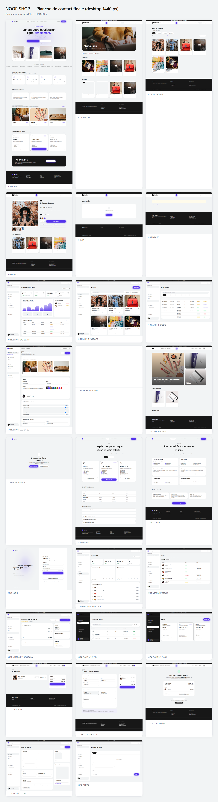

# NOOR SHOP

> Plateforme SaaS de création et de gestion de boutiques en ligne, pensée pour
> le marché sénégalais et l'Afrique francophone.

**NOOR SHOP** permet à un commerçant de lancer sa boutique en ligne en quelques
minutes, de gérer son catalogue, ses commandes et ses livraisons depuis une
interface pensée pour le mobile, et à l'opérateur de la plateforme de
superviser l'ensemble des commerçants, abonnements et offres.

Ce dépôt contient **la phase 1 du projet : la conception frontend complète**.
C'est un prototype statique (React + Vite + Tailwind) sans backend, destiné à
servir de référence visuelle et fonctionnelle pour la future intégration
Laravel + Inertia.js + MySQL.



---

## Sommaire

- [Vision du produit](#vision-du-produit)
- [Fonctionnalités du prototype](#fonctionnalités-du-prototype)
- [Périmètre non implémenté](#périmètre-non-implémenté)
- [Technologies](#technologies)
- [Démarrage rapide](#démarrage-rapide)
- [Scripts npm](#scripts-npm)
- [Architecture du dossier `src/`](#architecture-du-dossier-src)
- [Routes principales](#routes-principales)
- [Design system](#design-system)
- [Captures d'écran](#captures-décran)
- [Données de démonstration](#données-de-démonstration)
- [Qualité & tests](#qualité--tests)
- [État du projet & feuille de route](#état-du-projet--feuille-de-route)
- [Licence](#licence)

---

## Vision du produit

- **Marché initial** : Sénégal, avec extension prévue à l'Afrique francophone.
- **Devise** : Franc CFA (XOF), affichée partout avec `formatXof`.
- **Promesse** : « Lance ta boutique en ligne en moins de 10 minutes, depuis
  ton téléphone ».
- **Positionnement** : SaaS multi-boutiques avec trois modèles graphiques
  (Marble, Editorial, Gallery) et paiement à la livraison ou au retrait —
  aucun paiement en ligne n'est simulé dans le MVP.

Le cahier des charges intégral est dans [`docs/CAHIER-DES-CHARGES.md`](docs/CAHIER-DES-CHARGES.md).
La direction artistique de référence est dans [`docs/DESIGN-REFERENCE.md`](docs/DESIGN-REFERENCE.md).

## Fonctionnalités du prototype

Le frontend couvre quatre espaces :

**1. Site public NOOR SHOP**
- Landing, pages Fonctionnalités, Tarifs, À propos, Contact.
- Parcours d'inscription, connexion, mot de passe oublié, vérification e-mail (formulaires non branchés).

**2. Boutiques publiques** — trois modèles graphiques distincts
- Marble (`maam-couture`), Editorial (`teranga-beauty`), Gallery (`baobab-home`).
- Accueil, catégories, catalogue, recherche, fiche produit, panier, checkout, confirmation.
- Panier mono-boutique persistant en `localStorage`.

**3. Espace commerçant**
- Tableau de bord (KPIs, courbes, dernières commandes, alertes de stock).
- Catalogue (produits, variantes, catégories, stocks).
- Commandes (filtres, détail, historique, transitions de statut).
- Clients, statistiques.
- Personnalisation de la boutique (modèle, couleurs, sections, logo, réseaux).
- Livraison (zones), abonnement, paramètres.
- Wizard de création d'une nouvelle boutique.

**4. Administration de la plateforme**
- Supervision des commerçants et de leurs boutiques.
- Gestion des abonnements et offres (plans Découverte / Pro / Business).
- Journal d'activité, paramètres globaux.
- Confirmation modale sur les actions destructives (suspension d'une boutique).

## Périmètre non implémenté

> **Ces éléments sont intentionnellement absents du prototype frontend.**
> Ils sont prévus pour la phase d'intégration suivante.

- **Backend Laravel** et son API.
- **Base de données MySQL**, migrations, modèles Eloquent.
- **Authentification réelle** (sessions, JWT, permissions), gestion des rôles.
- **Paiements en ligne** — le MVP respecte le cahier des charges : paiement à la
  livraison ou au retrait uniquement.
- **Notifications transactionnelles** (e-mail, SMS, WhatsApp).
- **Stockage serveur** des images (CDN, redimensionnement).
- **Facturation récurrente** et cycles d'abonnement.
- **Intégrations externes** (Wave, Orange Money, cartographie).

Les boutons, formulaires et modales existent, mais leurs actions produisent
soit une mutation locale (`localStorage`, état React), soit un simple toast de
confirmation. Aucune donnée n'est envoyée à un serveur.

## Technologies

- **React 18** + **React Router 6**
- **Vite 5** (dev server + bundler)
- **Tailwind CSS 3** avec tokens personnalisés (couleurs, rayons, typographie)
- **JavaScript + JSX** (pas de TypeScript dans ce prototype)
- **Playwright** (scripts de revue visuelle, non inclus dans `package.json`)

## Démarrage rapide

```bash
# 1. Cloner
git clone <url-du-depot>
cd NOOR-SHOP

# 2. Installer
npm install

# 3. Lancer
npm run dev          # http://localhost:5173
```

Le serveur Vite affiche la landing publique à la racine. Explorez ensuite :

| Espace | URL |
|--------|-----|
| Site public | <http://localhost:5173/> |
| Boutique Marble | <http://localhost:5173/boutique/maam-couture> |
| Boutique Editorial | <http://localhost:5173/boutique/teranga-beauty> |
| Boutique Gallery | <http://localhost:5173/boutique/baobab-home> |
| Espace commerçant | <http://localhost:5173/merchant> |
| Administration | <http://localhost:5173/platform> |

## Scripts npm

```bash
npm run dev       # serveur de dev Vite (hot reload)
npm run build     # compilation production → dist/
npm run preview   # sert dist/ pour valider le build
npm run lint      # ESLint (si installé)
```

## Architecture du dossier `src/`

```
src/
├── App.jsx                 Routage central (BrowserRouter)
├── main.jsx                Bootstrap React + StoreProvider
├── index.css               Entrée Tailwind + tokens CSS
│
├── components/
│   ├── ui/                 Primitives du design system
│   │   ├── Button.jsx, Input.jsx, Card.jsx, Modal.jsx,
│   │   ├── DataTable.jsx, EmptyState.jsx, Stat.jsx,
│   │   ├── Logo.jsx, DemoBanner.jsx, Toast.jsx, Image.jsx
│   ├── layouts/            Shells par espace
│   │   ├── MarketingLayout.jsx, AuthLayout.jsx,
│   │   ├── StorefrontLayout.jsx, MerchantLayout.jsx,
│   │   └── PlatformLayout.jsx
│   └── commerce/           ProductCard, etc.
│
├── context/
│   └── StoreContext.jsx    Panier mono-boutique, store actif, toasts
│
├── data/                   Données fictives
│   ├── plans.js, stores.js, catalog.js,
│   └── orders.js, platform.js
│
├── lib/
│   └── format.js           formatXof, formatDate, slugify, classNames
│
└── pages/
    ├── marketing/          Landing, Features, Pricing, About, Contact
    ├── auth/               Login, Register, ForgotPassword, ResetPassword, VerifyEmail
    ├── storefront/         StoreHome, StoreCatalog, StoreProduct, StoreCart,
    │                       StoreCheckout, StoreConfirmation, NotFoundStore, …
    ├── merchant/           Dashboard, Products, ProductForm, Orders, OrderDetail,
    │                       Customers, Inventory, Analytics, Customization, Preview,
    │                       Delivery, Subscription, Settings, StoreCreate, …
    └── platform/           Dashboard, Merchants, Stores, Subscriptions, Plans,
                            Audit, Settings
```

## Routes principales

- **Site NOOR SHOP** : `/`, `/fonctionnalites`, `/tarifs`, `/a-propos`, `/contact`
- **Auth** : `/connexion`, `/inscription`, `/mot-de-passe-oublie`, `/reinitialiser-mot-de-passe`, `/verifier-email`
- **Boutiques publiques** : `/boutique/:slug`, `/catalogue`, `/produit/:slug`, `/panier`, `/commande`, `/confirmation/:token`
- **Commerçant** : `/merchant` + sous-routes (`produits`, `commandes`, `stocks`, `personnalisation`, `livraison`, …)
- **Plateforme** : `/platform` + sous-routes (`commercants`, `boutiques`, `abonnements`, `offres`, `journal`, `parametres`)

## Design system

- **Palette** : canvas `#F2F4F5`, surface `#FFFFFF`, encre `#171717`, violet accent `#5433EB`, violet-wash `#C0B5F3`.
- **Typographie** : GT Standard (avec Inter en repli) ; `letter-spacing: -0.014em` sur le body.
- **Rayons** : 28 px pour les cartes, 9999 px pour les pills, inputs, boutons.
- **Composants partagés** : `Button`, `Input/Select`, `Card`, `Modal`, `Badge`, `Pill`, `Stat`, `DataTable`, `EmptyState`, `Alert`, `Toast`, `Logo`, `Image` (avec fallback SVG), `DemoBanner`.
- **Mobile-first** : les grilles passent de 1 à 2 à 3/4 colonnes à partir des breakpoints `sm`, `md`, `lg`.
- Les sidebars des espaces commerçant et administration sont **sticky** en desktop (`lg:sticky lg:top-0 lg:h-[100dvh]`) et deviennent un drawer ouvert par un bouton `≡` en mobile.

## Captures d'écran

La revue visuelle finale regroupe **37 captures réelles** (desktop 1440 px + mobile 390 px) prises avec Playwright sur l'application en marche, plus une planche de contact et un rapport machine.

Voir [`docs/visual-review/final/`](docs/visual-review/final/) :

- [`INDEX.md`](docs/visual-review/final/INDEX.md) — liste et routes de chaque capture
- [`FINAL-REVIEW.md`](docs/visual-review/final/FINAL-REVIEW.md) — bilan de clôture : corrections appliquées, tests exécutés, bilan responsive, limites connues
- [`contact-sheet.png`](docs/visual-review/final/contact-sheet.png) — planche de contact (26 captures)
- [`_report.json`](docs/visual-review/final/_report.json) — résultats bruts (captures, interactions, parcours d'achat, responsive, erreurs console/réseau)

Scripts associés dans [`scripts/`](scripts/) :
- `final-review.mjs` — prise des 37 captures + tests Playwright
- `contact-sheet-final.mjs` — regénération de la planche
- `sticky-sidebar-check.mjs` — vérification du pin des sidebars

## Données de démonstration

Toutes les données affichées sont **fictives** et clairement signalées par un
bandeau noir « Données fictives » en haut des espaces boutique, commerçant et
plateforme.

Contenu démo :
- **3 boutiques** (Maam Couture, Teranga Beauty, Baobab Home), une par modèle graphique.
- **10 produits**, 7 catégories, variantes (tailles, couleurs).
- **6 commandes** couvrant les 6 statuts (En attente, Confirmée, En préparation, Prête, Terminée, Annulée).
- **5 commerçants** côté administration, journal d'activité, KPIs plateforme.

Les visuels produits proviennent d'Unsplash (CDN) ; le composant `<Image>`
fournit un fallback SVG propre si une URL devient indisponible.

## Qualité & tests

Le script [`scripts/final-review.mjs`](scripts/final-review.mjs) exécute dans
Chromium headless :

- **Parcours d'achat complet** — ouverture boutique → fiche produit → sélection
  variante → ajout panier → modification quantité → suppression → checkout →
  soumission → confirmation → vérification que le panier est vidé.
- **Vérifications UI** — chargement des formulaires, wizard, détail commande,
  listes d'administration.
- **Responsive** — 7 largeurs (320, 360, 390, 430, 768, 1024, 1440) × 6 pages
  clés = 42 contrôles de débordement horizontal.
- **Format monétaire** — scan de tout le `innerText` pour les regex `/FF CFA/`,
  `/F F CFA/`, `/NaN/`, `/undefined F CFA/`.
- **Erreurs** — interception des `pageerror`, `console.error` et
  `requestfailed`.

Résultats de la dernière passe : **0 overflow**, **0 problème XOF**, **0 erreur
runtime**, **12/12 étapes du parcours d'achat réussies**, **6/6 vérifications
d'interactions OK** — voir [`FINAL-REVIEW.md`](docs/visual-review/final/FINAL-REVIEW.md).

Pour rejouer la revue :

```bash
npm install --no-save playwright
npx playwright install chromium
npm run dev                             # terminal 1
node scripts/final-review.mjs           # terminal 2
node scripts/contact-sheet-final.mjs    # regénérer la planche
```

## État du projet & feuille de route

**Phase 1 — Conception frontend (clôturée)** ✅
- Design system, 3 modèles de boutique, 4 espaces, parcours d'achat,
  responsive 320→1440 px, captures de validation.

**Phase 2 — Intégration backend (à venir)**
- API Laravel (REST ou Inertia.js).
- Base MySQL, migrations, modèles Eloquent, Factories, Seeders.
- Authentification (Laravel Fortify / Sanctum), gestion des rôles (commerçant / admin).
- Persistence catalogue, commandes, abonnements.
- Upload d'images (Intervention Image + S3-compatible).
- E-mails transactionnels, mot de passe oublié.
- Gestion des cycles d'abonnement et période de grâce.

**Phase 3 — Mise en production**
- Hébergement, CDN pour les assets.
- Intégration passerelles de paiement locales (Wave, Orange Money, cartes).
- Supervision (logs, métriques, alertes).
- Préparation RGPD / protection des données.

## Licence

Le fichier de licence n'est pas encore rédigé. Jusqu'à décision du propriétaire,
**tous droits réservés**. Merci de ne pas réutiliser le code sans autorisation
explicite.

---

**NOOR SHOP** · Prototype frontend · Dakar, Sénégal.
